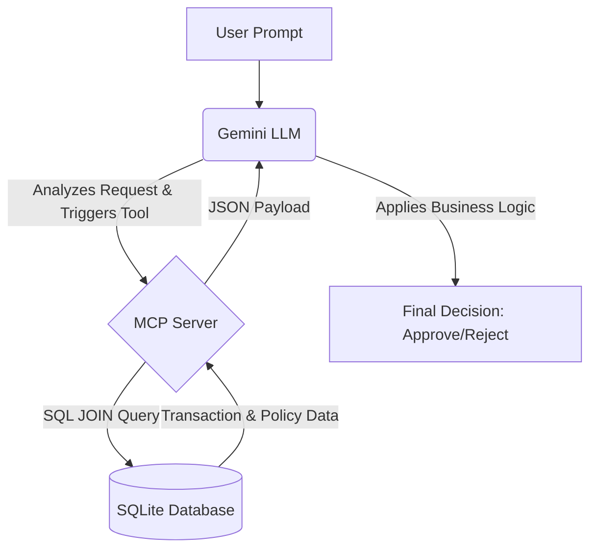

# AI-Powered Transaction Refund Engine (MCP)

## Overview
This project is an autonomous AI support agent that evaluates customer refund requests. Instead of hallucinating answers, the LLM uses the Model Context Protocol (MCP) to securely query a local database, fetch specific transaction details, check the merchant's refund policy, and make a deterministic "Approve/Reject" decision based on real data.

## Business Value
**Built to demonstrate secure LLM tool-calling, RAG patterns with structured relational data, and automated testing for fintech support workflows.** 

By isolating the database access via the Model Context Protocol (over standard I/O), this architecture ensures that the LLM never has direct network access to sensitive databases, demonstrating enterprise-grade security awareness.

## Architecture

Below is the execution flow when a customer submits a refund request:



## Tech Stack
* **Language:** Python 3.10+
* **AI API:** Google Gemini (Interactions API)
* **Protocol:** Model Context Protocol (MCP)
* **Database:** SQLite (Relational Data)
* **Testing:** Pytest

## How to Run

1. **Set up the environment:**
   ```bash
   python3 -m venv venv
   source venv/bin/activate
   pip install mcp pytest google-genai
   ```

2. **Initialize the database:**
   ```bash
   python3 src/db_setup.py
   ```

3. **Set your API Key:**
   ```bash
   export GEMINI_API_KEY="your-api-key-here"
   ```

4. **Run the AI Agent:**
   ```bash
   python3 src/client.py
   ```

## Running Tests
Run the test suite to verify the SQL logic and edge cases without invoking the LLM:
```bash
python3 -m pytest tests/ -v
```

## How to Run (Docker Recommended)
Ensure Docker is installed and your `.env` file is populated with your `GEMINI_API_KEY`.

```bash
docker compose up --build